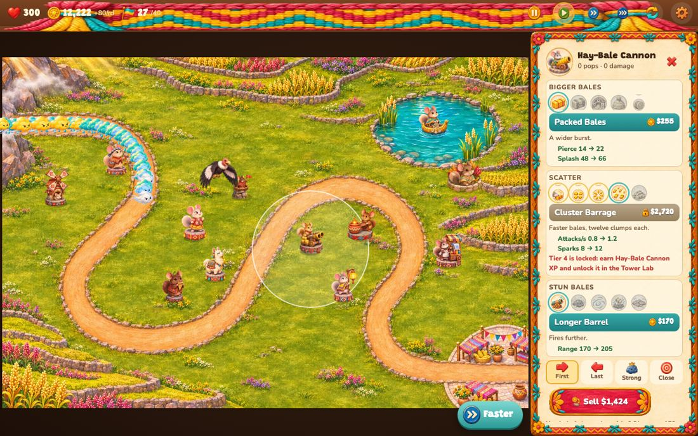
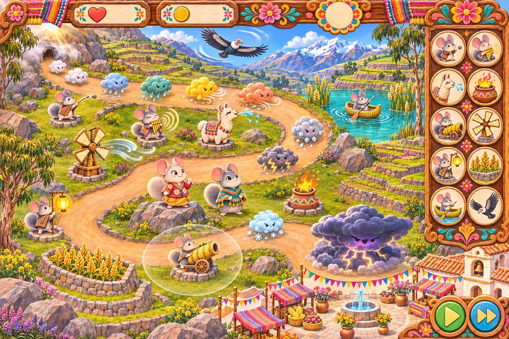
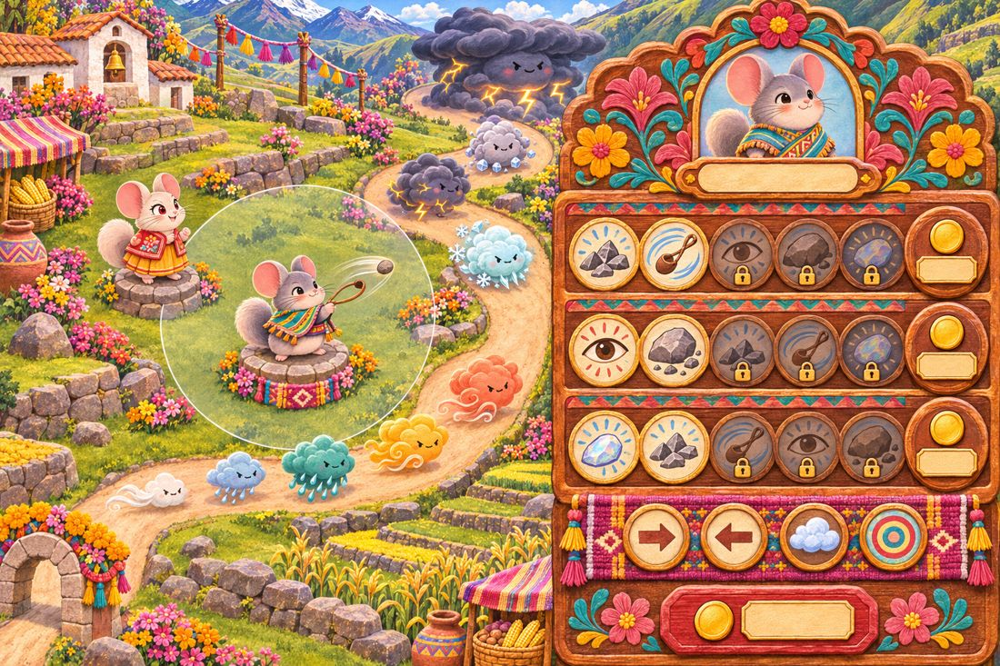
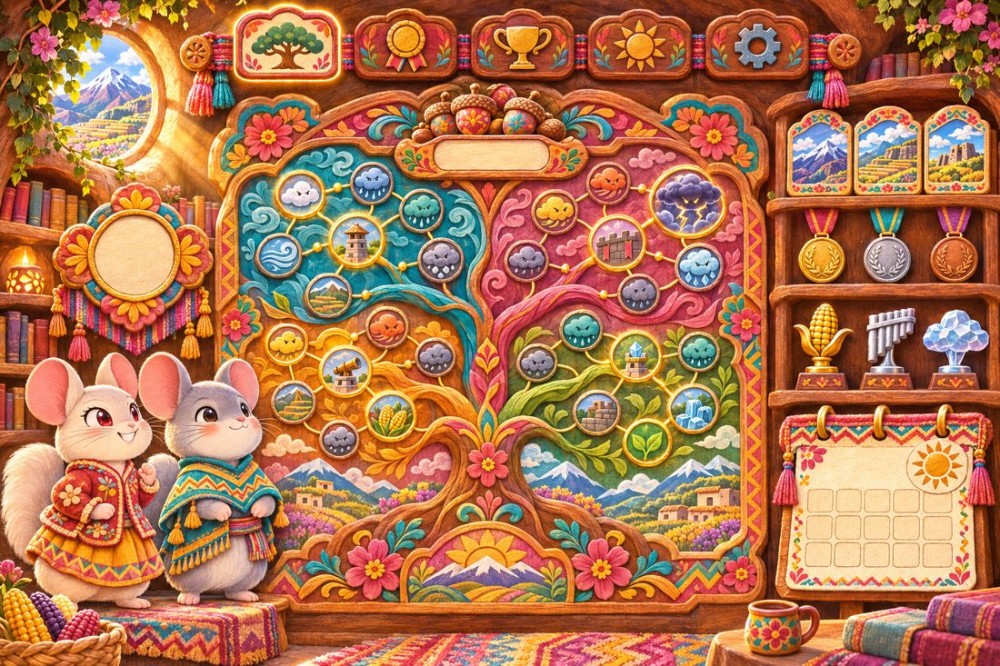

# Cloudpop

Game 103, `/cloudpop`. A tower defence of layered storm-puffs. The weather drifts down an Andean valley to rain out the chinchillas' harvest festival, and Dora, Enzo and the crew pop it one layer at a time. The genre is the popping-layers kind of tower defence; the cast, names, upgrades, enemies, maps, interface and art are all original. There are no monkeys and no balloons, and the opponents are weather, not Grumbles.

## Code layout

| File | What it holds |
| --- | --- |
| `lib/cloudpop-rng.ts` | mulberry32 and a string hash; every random choice is seeded |
| `lib/cloudpop-puffs.ts` | the 16 puffs and bosses: layers, children, speed, immunities, fortified hit points |
| `lib/cloudpop-towers.ts` | types for attacks, stats, abilities and upgrades; the crosspath rule |
| `lib/cloudpop-towerdata.ts` | the 11 towers, each with 3 paths × 5 named upgrades that edit the stats |
| `lib/cloudpop-heroes.ts` | Dora and Enzo, levels 1–20, their abilities and looks |
| `lib/cloudpop-maps.ts` | the 8 maps: roads (Catmull-Rom smoothed, resampled every 4 px), water, blockers, no-build zones |
| `lib/cloudpop-rounds.ts` | 100 hand-written rounds in a one-line format, seeded freeplay past 100, the round curve |
| `lib/cloudpop-game.ts` | the `Game` class: rules, commands (place, upgrade, sell, target, ability, start round), economy |
| `lib/cloudpop-sim.ts` | one fixed step (1/30 s): movement, targeting, attacks, projectiles, damage and popping |
| `lib/cloudpop-meta.ts` | the save, player level, Tower Lab, Burrow Lore, medals, trophies, run rewards, the daily |
| `lib/cloudpop-info.ts` | stats at any tiers and the plain-language "what this upgrade changes" list |
| `lib/cloudpop-art.ts` | generated by `scripts/cloudpop-art.py`: atlas frames and the water masks |
| `lib/cloudpop-scene.ts` | Canvas 2D drawing only: the painted map, sprites, effects, range rings, the portrait quarter-turn |
| `app/cloudpop/controller.ts` | the loop (1×/2×/3×, pause), pointer and keys, sounds, the end of a run |
| `app/cloudpop/page.tsx` | the save and screen switching; `play.tsx` (HUD), `menus.tsx`, `meta.tsx`, `sound.ts`, `ui.tsx` |

The engine has no DOM and is deterministic: the same `RunConfig` and seed replay the same run exactly (a test checks this). The browser exposes `window.__cp` (the controller), `window.__cloudpop()` (a state snapshot) and `window.__cloudpopSave()` for the browser test.

## Rules and numbers

**The world** is the map painting, 1536 × 1024. Roads are 58 wide. On a phone held upright the valley turns a quarter turn so it fills the screen; sprites stay upright.

**Puffs.** A puff has layers. Each hit takes one layer (more with more damage), each popped layer pays $1 (falling to $0.5 after round 50, $0.3 after 60, $0.15 after 80 and $0.05 after 100), and spare damage carries into the next layer.

| Puff | Layers | Pops into | Notes |
| --- | --- | --- | --- |
| Wisp, Drizzle, Shower, Squall, Gale | 1–5 | the one below | each faster than the last (Gale 3.2× a Wisp) |
| Rumble | 1 + 2 Gales | 2 Gales | Heavy can't hurt it |
| Frost Puff | 1 + 2 Gales | 2 Gales | Cold can't hurt it; can't be chilled or frozen |
| Hail | 1 + 2 Rumbles | 2 Rumbles | Light can't hurt it |
| Tempest | Rumble + Frost | both | Heavy and Cold can't hurt it |
| Cloudburst | 2 Tempests | 2 Tempests | |
| Sleet | 10 hits | 2 Cloudbursts | |
| Thunderhead (boss) | 200 hits | 4 Sleets | first at round 40 |
| Whirlwind (boss) | 400 hits | 4 Sleets | fast, always at night, Light can't hurt it |
| Anvilhead (boss) | 700 hits | 4 Thunderheads | round 60 |
| Stormcrown (boss) | 4,000 hits | 4 Anvilheads | round 80 |
| Huracán (boss) | 20,000 hits | 2 Stormcrowns + 3 Whirlwinds | round 100 |

Modifiers: **night** puffs can only be targeted by towers with sight (several upgrades grant it; the Lantern Keeper and Windmill can strip night off puffs); **fog** puffs regrow a layer every 3 seconds they go unhit; **roped** (fortified) puffs take double hits (Hail takes 4). Magic damage hurts everything. Bosses gain hit points after round 80.

**Damage types:** Light, Heavy, Fire, Cold, Sound, Spit, Wind, Magic.

**Lives.** A puff that reaches the festival costs a life for every layer it still has. Easy starts with 200 lives, Medium 150, Hard 100; Assist (on by default) gives half again as many, a 20% bigger round bonus, and one second chance (half your lives back once). Endless Storm starts with 50 and no second chance.

**Coins.** $650 to start. Prices are ×0.85 on Easy and ×1.08 on Hard. The round bonus is $100 + the round number. Selling refunds 70% of what the tower cost (more with lore). Quinoa Terraces and some upgrades pay income each round.

**Rounds.** Easy is won at round 40, Medium at 60, Hard at 80; then you can keep going in freeplay. The 100 authored rounds are written one per line (`"12 sleet.x 0.6 @4"` is 12 roped Sleets, 0.6 s apart, starting at 4 s; `.n` night, `.f` fog), with boss rounds at 40, 60, 80 and 100. Total layers per round (seed 1): round 1: 20, 10: 200, 20: 138, 30: 345, 40: 716, 50: 3,004, 60: 4,304, 70: 14,544, 80: 35,640, 100: 142,832. Past 100, freeplay rounds are generated from the seed and get faster.

**Modes.** Standard; Uphill (the road runs backwards); Single Kind (Easy: one tower kind plus your hero); Lean Harvest (Medium: no Quinoa Terraces or income upgrades, half the round bonus); Nightfall (Hard: every puff comes at night); Endless Storm (Hard: rounds 6 to 100, 50 lives, no lore perks, +$1,200 to start).

## Towers

Each tower has three paths of five upgrades. **Crosspath rule:** one path may go to tier 5, one other path to tier 2, and the third stays shut. Tiers 1–3 are always open; tiers 4 and 5 are unlocked per path in the Tower Lab. Each tower's look changes at tier 3 and tier 5 of each path (seven looks, each with an attack frame).

| Tower | Cost | Unlocks | Role | Paths | Tier 5s |
| --- | --- | --- | --- | --- | --- |
| Pebble Slinger | $200 | level 1 | cheap single shots | Flint / Quick Wrist / Long Eye | Avalanche Arm, Pebblestorm, Moonstone Marksman |
| Pan-Flute Busker | $290 | 1 | sound rings all round | Big Band / Tempo / Lullaby | Song of the Mountains, Endless Fiesta, Hush of the Valley |
| Llama | $250 | 1 | spit that slows | Sour Spit / Big Spit / Stubborn | Grand Gob, Monsoon Llama, Alpha Llama |
| Hay-Bale Cannon | $540 | 1 | heavy splash | Bigger Bales / Scatter / Stun Bales | Harvest Moon Bale, Bale Bonanza, Earthshaker |
| Ember Pot | $380 | 2 | burning splash | Blaze / Firebrands / Smoke & Sparks | Heart of Misti, Phoenix of the Andes, Everflame |
| Raspadilla Cart | $450 | 3 | freezes puffs | Deep Freeze / Shards / Chill Air | Eternal Glacier, Blizzard Engine, Apu's Winter |
| Quinoa Terrace | $1,000 | 3 | income each round | Harvest / Market Day / Potato Keepers | Breadbasket of the Andes, Great Fair, Harvest Blessing |
| Condor Roost | $880 | 4 | a flier on patrol, builds anywhere | Talons / Feather Volley / Patrol | Apu Condor, Flock of the Sun, Lord of the Wind |
| Lantern Keeper | $900 | 4 | reveals night clouds, buffs | Moonlight / Festival Glow / Market Lanterns | Lantern of Mama Killa, Sun Festival, Festival Treasury |
| Reed Boat | $420 | 5 | water only | Nets / Lake Cannon / Fishing | Lake Queen, Titicaca Dreadnought, Golden Totora |
| Windmill | $600 | 6 | blows puffs back | Gusts / Millstones / Weather Vane | Puna Hurricane, Great Grinder, Weather Keeper |

Nineteen of the 33 tier 5s give an activated ability (40–90 s recharge), for example Rockslide, Eruption, Big Chill, Llama Flood, Stampede, Sky Strike, Blow Back, Moonrise, Sunburst and Big Catch. Targeting is First, Last, Strong or Close. The upgrade panel shows each tier's name, price, a sentence, and the exact stat changes ("Pierce 14 → 22"), and each tower counts its pops and damage.

**Heroes.** One per run. Dora, Festival Dancer ($520): quick petal throws; Ribbon Whirl at level 3, Sun Dance at 10 (every tower 40% faster), Inti's Blaze at 20 (400 damage to every puff). Enzo, Storm Scholar ($600): heavy clay pots; Weather Vane at 3 (slows everything), Lightning Rod at 10, Clear Skies at 20 (strips night and fog, then hits every puff). Heroes earn XP from pops and from each round. Enzo unlocks after your first win or at player level 3. Looks: Dora's Moonlit Fiesta (trophy "Steady Storm", win on Medium) and Enzo's Harvest Gold (pop 50,000 layers).

## Maps

| Map | Tier | Opens at level | Notes |
| --- | --- | --- | --- |
| Terrace Meadow | beginner | 1 | long lazy road, a pond for the boats |
| Llama Loop | beginner | 1 | the road circles a pasture; the middle reaches it twice |
| Salt Flat Crossing | intermediate | 3 | open salt, shallow lagoons, a no-build salt pan |
| Twin Falls | intermediate | 5 | two roads that meet, two waterfalls |
| Condor Canyon | advanced | 8 | seven rock pillars block line of sight |
| Reed Isles | advanced | 10 | mostly lake: boats shine |
| Cloud Forest Switchbacks | expert | 14 | nine trees block line of sight |
| Summit of the Storm | expert | 18 | two crossing roads, cliffs, blockers |

A map also opens early once you win any medal on the map before it. Water is measured from each painting on a 16 px grid. Lobs (Hay, Ember, Boat cannon) and the Windmill's gusts arc over blockers; straight shots do not.

## Between runs

All of it lives in `localStorage` under `cloudpop-v1`, read through `loadSave`, which repairs or clamps every field, ignores saves from a newer version, and migrates the prototype's v0 `unlocks` list. Every read and write is wrapped in try/catch.

- **Player level** from XP: 10 per round won plus 200 for a win, ×1.5 on Medium and ×2 on Hard. Levels open towers and maps.
- **Tower Lab:** each tower earns its own XP from its pops; tier 4 costs 1,500 of that tower's XP and tier 5 costs 6,000, per path.
- **Burrow Lore:** 44 nodes in four branches of eleven (Crew, Wonders, Hearth, Legend), bought with acorns. A node opens once any of its parents is learned. Acorns come from rounds (1 per 5), wins (6/10/16 by difficulty, ×1.5 in other modes), new medals (+5), trophies (+3) and the daily (+12).
- **Medals** per map × difficulty × mode, **32 trophies**, two hero looks.
- **Daily challenge:** one seeded setup per calendar day (map, difficulty, a 15-round stretch starting between rounds 5 and 24, four towers, starting coins, a hero), with a streak.

## Art pipeline

All art is painted by Codex (`codex exec` with the image tool); code draws only effects, rings and trails. The three mock-ups came first and every later sheet was painted with them attached as references, plus the arcade's Dora-and-Enzo reference pair:

- `docs/cloudpop-art/gen.sh` and `docs/cloudpop-art/prompts/` are the generator and every prompt (`_style.txt` is appended to all; `_sheet.txt` describes the 4×4 sprite grid). Sprite sheets are painted on flat magenta (UI pieces on green). Maps were painted over a road guide drawn from the waypoints, then the waypoints were nudged to the painted roads and checked with overlays.
- `scripts/cloudpop-art.py <art-src>` keys the sheets, pulls the magenta cast out of fur and cloud edges, cuts the 4×4 cells (keeping the biggest blobs), packs six WebP atlases (towers ×2, heroes, puffs, icons, UI), writes the maps and backgrounds as WebP, measures the water masks, and generates `lib/cloudpop-art.ts`. 540 frames; `public/art/cloudpop/` is about 10 MB.
- Every tower has 7 looks × 2 frames (idle and attack) plus projectiles, 15 upgrade icons and a portrait; each hero has idle ×2, wind-up, throw, two frames per ability, cheer, land, worry, win, a face and a projectile, in three looks; every puff has two frames, every boss a hurt frame; pops, splashes and status overlays are painted too.

Dora is cream-white with red eyes and Enzo is grey; they are chinchillas in festival clothes with no signature items.

## Tests

- `tests/cloudpop.mjs` (26 tests): determinism, popping and overflow, splitting, immunities, fortified and boss hit points, night sight, the crosspath rule, Lab caps in a run, placement (road, water, spacing, blockers), prices and selling, the economy and Lean Harvest, every tower's 15 upgrades (names unique, costs rising, each changes a visible stat, each has an icon, each look painted), tier-5 abilities, heroes, puff art, maps, the round curve and boss rounds, abilities and cooldowns, Assist's second chance, the save, Burrow Lore, the Tower Lab, run rewards, the daily and the modes.
- `tests/cloudpop-bot.mjs`: whole runs through the engine. Bots look at the valley every 200–300 ms of game time and place towers imperfectly (a spot picked from the better third of the valley, missed by up to about a tower width). `--quick` is part of `npm test`.
- `tests/e2e/cloudpop.mjs`: 282 checks clicking every menu button, setup option and in-run action at 1280×800, 390×844 (touch) and 844×390 (touch); fails on page errors or sideways scroll.

### Bot results (13-11-2026)

| Bot | Run | Result |
| --- | --- | --- |
| casual (new save, level-1 towers, Assist) | Easy · Terrace Meadow | 12/12 won, ~182 lives left |
| casual | Easy · Llama Loop | 12/12 won, ~286 lives left |
| strategy (level 20, Lab open, a few lore perks) | Medium · Meadow, Salt Flat, Condor Canyon | 9/10 won |
| strategy | Easy · Summit of the Storm | 3/3 won |
| casual | Medium · Terrace Meadow | 1/6 won (lost at 40–46) |
| strategy | Hard · Meadow and Cloud Forest | 0/7 won, lost between rounds 43 and 70 |

Balance changes made from these: tier 3 open from the start, tier 3 prices ×0.75 and tier 4 ×0.8, and rounds 41–46 and 56–58 eased (the bosses spaced out). The bots enforce casual ≥ 90% on Easy and strategy ≥ 80% on Medium.

## What is weakest

- **Hard is unproven.** No bot has won Hard; the strategy bot reaches rounds 64–70 of 80. A skilled human with good tier-5 picks probably can, but nothing shows it yet. Rounds 64–80 may need easing.
- **The strategy bot is simple:** it spreads money over many towers and has no notion of which tier 5s are strong, so it says little about upgrade balance. A rough damage-per-coin check shows some tier-3 and tier-5 upgrades are still poor value next to spamming cheap tiers.
- **Readability at speed:** with 3× speed and big crowds the puffs overlap; status overlays (ice, burn, stun) are small on phones.
- **No tutorial.** The first round is gentle and the panel explains every upgrade, but nothing walks a new player through night or immune puffs except the next-round preview's hints.
- **Sound is synthesised** (WebAudio): pleasant but simple next to the painted art.
